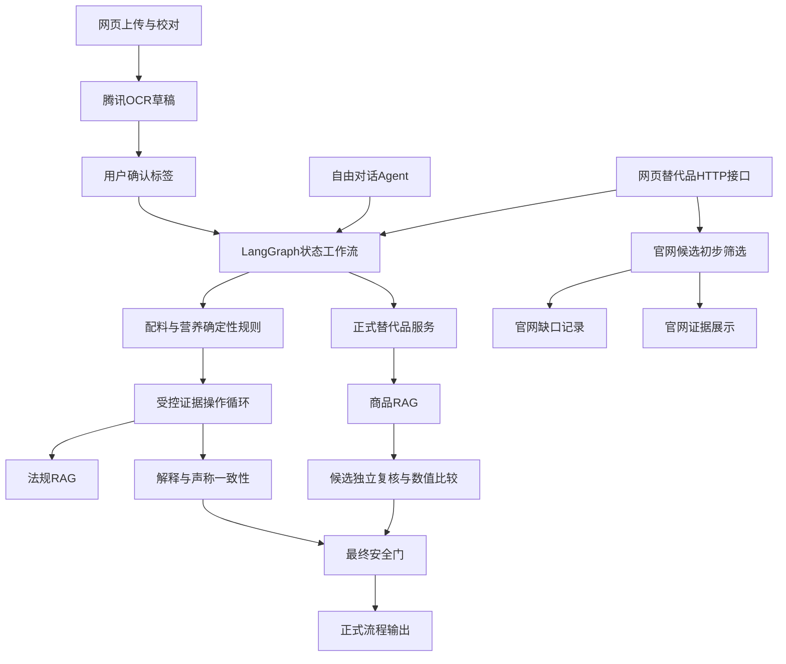

# 项目与 Agent 知识架构：自顶向下审查

> 本文是重构前的审查快照。入口、官网证据索引和补齐对账的后续修复见 [ADR-012](../ADR-012-unified-product-evidence-flow.md)；会话持久化等未解决事项仍保留。

审查日期：2026-10-05。依据当前工作区代码、架构记录、只读本地运行状态和正式知识文件。没有改动业务逻辑、生产配置、数据或部署。本文是架构分析，不是渗透测试或独立医疗安全认证。现有701项测试的通过结果来自上一轮验证，本轮没有把它等同于真实用户准确率。

## 1. 总体定位

项目是一套面向中国大陆食品标签解释和替代品筛选的证据优先决策系统。技术形态为 Python 模块化单体，加独立知识更新进程；前端是原生 HTML/CSS/JavaScript，HTTP 服务使用 Starlette，运行在 Uvicorn 上。它不是微服务系统，也不是多个独立自主 Agent 协作系统。

Agent 的主要价值是按任务状态组织证据操作、利用工具检索解释依据、支持用户追问。风险等级、字段可信度、数值比较及推荐资格主要由程序控制。整体更准确的表述是“受控 Agent + 确定性业务引擎 + 双语料检索 + 证据治理”。

## 2. 顶层职责分层

| 层 | 责任 | 主要代码 |
| --- | --- | --- |
| 产品入口 | 上传、校对、约束、结果、聊天、审核页面 | web/ |
| 应用编排 | 接口授权、检查点恢复、流程调用、响应组织 | web/app.py, graph/workflows.py |
| Agent 控制 | 状态图、路由、受限动作选择、工具预算、终止 | graph/ |
| 业务判断 | 配料解析、过敏、营养、声称、替代资格 | ingredients/, nutrition/, claims/, alternatives/ |
| 知识检索 | 法规条款和商品证据分别召回、重排 | regulations/, alternatives/rag.py |
| 数据治理 | 来源、版本、图片、字段观察、冲突、审核、补齐 | alternatives/knowledge.py, field_evidence.py, discovery.py, completion.py |
| 基础设施 | OCR/模型接口、SQLite、定时更新、审计评测 | ocr/, persistence/, observability/, evaluation/ |

知识治理与业务判断是独立职责：检索到文本，不等于字段可信；字段可信，不等于满足这次用户约束。

## 3. 当前真实数据流

图中官网初步筛选是 HTTP 层追加结果，尚未完全进入共同工作流，也不是商品 RAG 的一个文档来源。聊天调用共同替代工作流时，没有自动经过 HTTP 层这段追加逻辑。这会造成相同需求在网页与聊天入口下可见证据不同。

## 4. Agent 的两种运行形态

### 标签工作流

AgentState 显式保存 request_id、法域、适用日期、状态、OCR证据、确认字段、用户约束、标准化结果、风险、法规证据、替代结果、未知项与追踪。领域状态由项目定义，LangGraph 负责连接节点；状态不是仅存在于聊天上下文中。

主流程为输入校验→OCR→确认或暂停→结构化→风险评估→受控证据循环→可选替代检索与复核→最终安全门。确认不足、解析不确定、风险条件等由路由决定暂停，模型不能随意跳过。

ReAct 循环允许的工具包括法规搜索、配料解释、声称解释、一致性核查。归一化、安全评估及最终门在循环外。当前健康接口显示 Planner 为 deterministic；代码支持模型提议 action_id，实际参数由可信状态构造，并有动作白名单、预算及异常回退。

因此，项目确实有 Agent 编排，但并非所有节点都由大模型决定，更不是让模型随意规划任何网站、代码或API操作。

### 自由对话

ConversationAgent 使用模型生成自然语言与受控工具调用，绑定已确认状态、结构化对话商品和用户约束。紧急症状先走本地规则；模型输出还经过边界检查。它与标签状态图互相调用，但不是同一个控制循环。

应保留这一区分：聊天负责理解和表达，业务工具负责可复核判断；不得把聊天文字直接覆盖结构化风险。

## 5. MCP 与工具边界

business_tools.py 注册9类业务工具：标签归一化、用户约束检查、法规搜索、配料解释、声称解释、一致性核查、替代搜索、商品比较、替代复核。MCP server 可暴露这些能力；应用内部 invoke_mcp_tool 目前可直接分发到本地 Python handler。

所以 MCP 是工具契约和暴露边界，并不意味着每次调用都跨网络，也不是 RAG 数据库。当前应用 Agent 没有任意网页抓取或shell执行能力。本次研发过程中由开发助手手动找官网资料，不能算产品 Agent 自己已经具备自动互联网研究能力。

## 6. 法规 RAG

语料来自内置官方条款及 regulations/data JSON。当前加载201条条款，涉及4个标准编号。条款数不等于完整覆盖4部标准的全部内容，更不等于所有相关法规。

检索先按法域、日期、主题和显式标准号筛选，再做 BM25 与向量召回、RRF融合，按配置进行独立重排，返回证据ID、条款和适用版本。当前服务配置为 hybrid_dense_rerank，embedding为text-embedding-3-large，reranker为gpt-5.6-terra；配置启用不等于本轮实际执行过远程召回性能评测。

支持 bm25、hybrid_tfidf、hybrid_dense、hybrid_dense_rerank。远程法规检索提供器失败时，会带提示回退本地混合检索。TF-IDF是本地稀疏文本表示，不等于语义embedding模型。

法规库回答“如何解释规则及声称”，不能回答某具体商品实际有多少糖。该语料当前通过导入与进程缓存加载，未发现商品月度worker同时自动更新法规语料；法规更新后需要明确处理缓存失效与回归。

## 7. 商品 RAG

ProductRAG._documents 当前构造三种证据文档：传入正式商品目录标签、SQLite的OFF外部详情、外部商品OCR草稿。层级分别包括 catalog_evidence、external_unverified、ocr_draft。每份文档保留产品ID、来源、版本、字段观察和缺口。

它不是每个商品一个“安全向量”。检索相关性只影响候选顺序，目录商品还要独立进行证据与约束复核，外部文档/OCR草稿召回不会自动创建合格推荐。

查询来自用户明确检索文字、当前商品、品类和健康关注映射。召回使用BM25和dense向量，RRF采用1/(60+rank+1)融合，独立重排前20份证据，并校验返回ID。向量缓存保存在SQLite product_vectors，按模型/维度与文本摘要复用。检索失败会显式降级。

当前没有专门的ANN向量数据库；BM25等索引在查询路径构建，dense相似度在程序内计算。小语料可用，数量增长后需测量再考虑持久索引、批量加载、向量服务。现阶段不应把替换向量数据库作为首要改进。

重要限制：当前官方发现JSON中的77条候选并未直接进入上述_documents。它们主要由 source_screening.py 处理，不应把“官网候选增加”描述为“商品向量库新增相同数量的商品”。

## 8. 官网初步筛选与证据层

网页接口在正式工作流返回后，单独读取官网发现队列并运行规则筛选。该路径按特定source_id白名单、品类、地区、来源异常和35天检查时间筛选，检查营养上限、明确相对比较和部分配料冲突，返回matched、not_matched、unknown、not_evaluated。

这些结论属于具体查询，不是永久商品属性。matched仅表示现有官网数据符合列出条件，recommendation_eligible仍为false。明确配料冲突可以排除；未找到冲突不能推出满足过敏限制。

ingredient_profile仅提取原文中明确出现的糖类配料、糖醇、其他甜味剂、乳蛋来源及纤维相关成分，保留证据位置。没有将缺失值变成0，也不把白砂糖出现与总糖数值混为一谈。

当前各层尚有不同的数据契约：正式ProductRecord及包装证据模型、OFF原始JSON与字段观察、官网自由字典及提取记录。审核状态在多处存在，适用期限也有35天、550天及字段/包装自带有效期等不同含义，应明确而非简单统一成一个日期。

## 9. 数据闭环与实际规模

截至本次只读检查：

| 数据面 | 记录/状态 |
| --- | --- |
| 官网发现队列 | 77条，均evidence_incomplete |
| 当前酸奶模拟样本 | 39条，包含同配方不同规格 |
| OFF商品详情 | 122条 |
| OFF字段观察 | 717条 |
| 商品向量缓存 | 33条缓存记录，不等于33个商品 |
| 外部缺口队列 | 16条商品任务 |
| 官网真实缺口队列 | 0条；模拟任务另库存放 |
| OFF含sugars_100g的记录 | 58条，字段存在不代表核验通过 |
| 当前官网酸奶可用总糖补齐 | 仍未取得可可靠对应的数值 |

77与122不可直接相加宣称唯一商品总数；不同数据源之间缺少统一去重与身份映射证明。OFF的58条糖数值，也不能因名字相似转填到国内当前规格；需核对条码、地区、规格、口味、包装版本及证据。

月度Worker负责OFF分类发现、详情补齐、图片OCR、官网注册来源复查和批量评估。使用日历月计划、作业锁、失败保留旧数据。

但有两套补齐队列：completion_queue由OFF worker实际按优先级消费；official_completion_tasks由网页初步筛选记录，当前worker没有对应通用消费者。其not_declared和same_source_retry_allowed字段表达策略，但不能据此声称官网的抓取、识别、审核和任务关闭已全自动完成。

卡士与明治public_extracts是人工获取的公开页面文字导入，新增来源仍需人工复查；简爱和桂格已有结构化适配器。后台服务启动不等于所有来源都能自动更新成功。

## 10. 存储、运行配置与部署差异

代码具备文件SQLite检查点、授权记忆、对话和备份能力；知识库JSON与SQLite已经落到正式数据目录。

然而当前本地健康接口返回storage.durable=false、conversation_storage.durable=false。启动脚本使用food_label_agent.web.app:app，而非create_production_app。默认create_app构造内存存储，production工厂才显式传文件数据库并要求访问配置。

这意味着当前网页的工作流与对话状态会随进程重启丢失；并不意味着商品知识数据库也在内存里。README描述的持久化能力与当前实际入口需要区分。这是应优先修正的部署一致性问题，本次分析没有擅自切换入口或修改访问配置。

本地路径、启动脚本和部分人工提取时间还有机器绑定特征，正式部署需环境化；没有理由现在拆成大量微服务。

## 11. 主要优点与缺口

已具备的良好结构：确认事实与草稿分开，规则与生成分开，法规与商品语料分开，召回分数不等于资格，显式未知，字段来源和版本可追溯，有预算/错误回退/审计/测试。

优先缺口：

1. 网页本地运行入口未使用持久检查点和对话库。
2. 官网新证据尚未统一进入ProductRAG和聊天共同服务，网页存在额外能力分支。
3. 官方补齐队列缺消费与审核反馈执行闭环；模拟数据不能算真实需求驱动已验证。
4. 产品身份、版本和字段观察尚未统一，存在同名、多规格和不同市场配方混用风险。
5. 确定性能力支持矩阵需要明确：解析器/核心安全规则/官网初筛支持的过敏、回避、营养、不耐受与饮食约束不完全相同；不能把UI能输入等同于引擎已支持。
6. 同步HTTP处理器内有工作流及远程调用，存在阻塞事件循环风险，应测量后转线程池或后台任务。
7. 商品检索路径有逐商品字段与批量状态读取、临时索引构建，可能出现N+1查询及查询延迟增长。
8. 长期保留表、向量缓存和缺口事件需要清理/版本策略；暂无证据足以称其已支持大规模高并发。
9. README、部分模块注释和后续实现时间不一致，旧测试与旧商品数不宜作为当前状态。

## 12. 建议的目标结构与优先级

目标不是让更多业务决策交给大模型，而是让所有入口共享可信商品服务：网页/聊天/MCP→统一需求对象→统一商品身份和字段证据→RAG候选召回→确定性约束复核→解释与补齐任务。

建议统一保留：ProductIdentity（品牌、名称、口味、规格、条码可空、市场、版本）；EvidenceRecord（来源、图片/文本、内容摘要、记录与复查时间）；FieldObservation（值/单位/口径/原文/审核/版本）；ConstraintAssessment（查询、条件、结论、证据ID）；CompletionTask（缺口、优先级、状态、来源策略、重试时间）。审查和采集与运行时推荐分开。

实施顺序：

- P0：修正本地持久化入口并用重启恢复测试验收；将官网初筛从HTTP handler抽到共同业务服务，确保聊天/网页同条件一致。
- P1：把官网候选作为明确未核验层级接入商品证据索引，统一字段模型及来源版本；完成官网任务消费者、重试控制和审核后回写。
- P2：建立真实商品—查询—预期证据的独立标注集，再做RAG开关、BM25/dense/rerank消融对照，观察召回、错误通过、未知率和延迟/成本。
- P3：在规模和延迟数据证明需要后，再升级检索索引、数据库和任务基础设施。

现有701项测试与50组合成预期用例主要证明程序边界和回归稳定，不能证明实际OCR准确率、真实替代品满意度、法规覆盖完整或联网检索收益。50组中部分为边界/表达变体，不应当作50位真实用户。

## 代码核对入口

- graph/runtime.py、graph/langgraph_adapter.py、graph/react.py、graph/planner.py、graph/state.py
- conversation/service.py、context/builder.py
- mcp/business_tools.py、mcp/server.py
- regulations/store.py、regulations/service.py、regulations/semantic.py
- alternatives/rag.py、service.py、evidence_audit.py、models.py
- alternatives/knowledge.py、field_evidence.py、batch.py、refresh.py
- alternatives/discovery.py、source_screening.py、public_extracts.py、completion.py、ingredient_profile.py
- web/app.py、scripts/run_local_platform.sh、persistence/sqlite.py

所有上述路径均相对项目根目录。结论以当前源码调用关系为准，不以ADR中的“已实施”文字替代接线核查。
